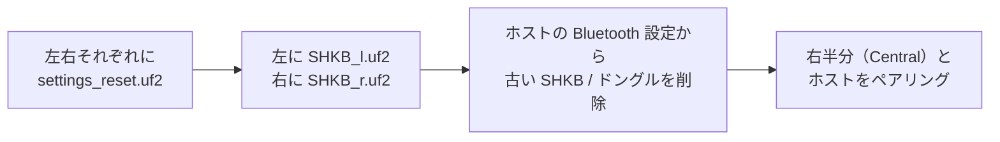
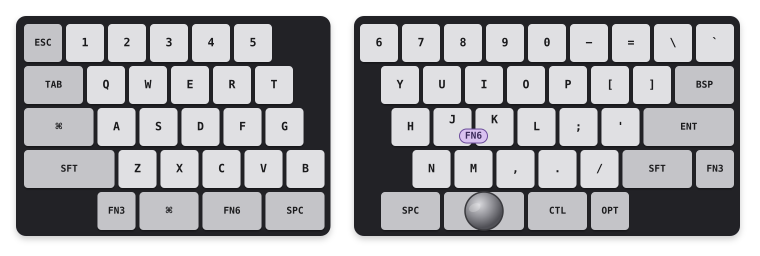
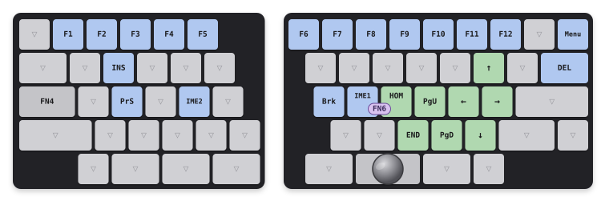
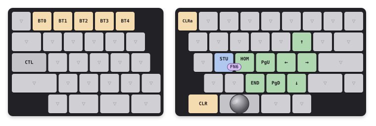
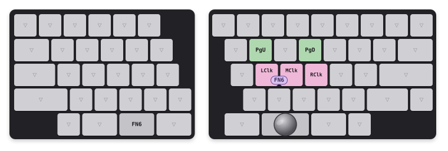
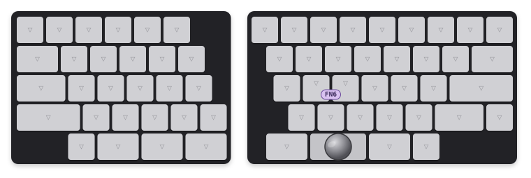
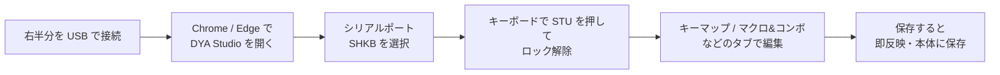
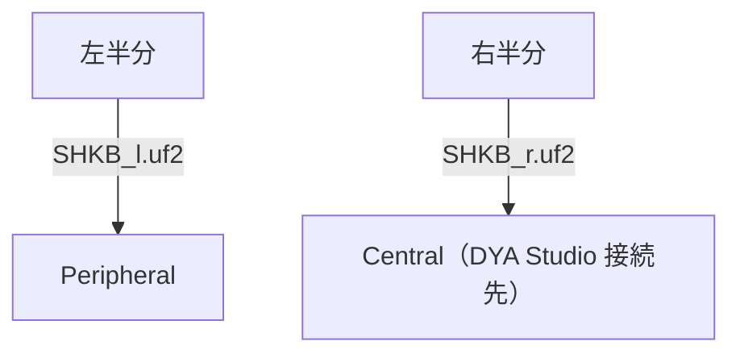

# SHKB

HHKB レイアウトをベースにした 62 キーの左右分割キーボードです。右半分にトラックボール（PMW3610）を搭載しており、ZMK ファームウェアで動作します。

> [!IMPORTANT]
> 現在の `main` は [DYA Studio](https://studio.dya.cormoran.works/) に対応した版です。キーマップ・コンボ・マクロ・トラックボール・接続先ごとのレイヤーを、ファームウェアをビルドし直さずにブラウザから変更できます。代わりにドングルモード（Prospector を含む）には対応していません。Keymap Editor 前提の旧版（ZMK v0.3）は [`keymap-editor-v0.3`](https://github.com/chb-usk/zmk-config-SHKB/tree/keymap-editor-v0.3) ブランチに残しています。旧版との違いは [DYA Studio 対応での変更点](#dya-studio-対応での変更点) を参照してください。

---

## 概要

| 項目 | 内容 |
|------|------|
| キー数 | 62 キー（左 28・右 34） |
| キーピッチ | 17mm |
| マイコン | Seeed Studio XIAO nRF52840 |
| トラックボール | PMW3610, 19mmトラックボール |
| ファームウェア | ZMK（[cormoran/zmk](https://github.com/cormoran/zmk) `main+dya`、Zephyr 4.1） |
| 設定ツール | [DYA Studio](https://studio.dya.cormoran.works/)（ブラウザ） |
| 接続 | BLE 無線 / USB（右半分を直結） |

---

## DYA Studio 対応での変更点

旧版（`keymap-editor-v0.3` ブランチ、ZMK v0.3）からの主な変更です。

| 項目 | 旧版（ZMK v0.3） | 現在の版（DYA Studio） |
|------|------------------|----------------------------|
| ZMK 本体 | zmkfirmware/zmk v0.3（Zephyr 3.5） | cormoran/zmk `main+dya`（Zephyr 4.1） |
| キーマップの変更 | `.keymap` を編集してビルド（Keymap Editor の GitHub 連携） | DYA Studio で変更して即反映（ビルド不要） |
| コンボ・マクロ | `.keymap` に記述 | DYA Studio で作成・編集。`J`+`K` の Scroll コンボは初期値として `.keymap` に定義 |
| 接続先ごとのベースレイヤー | BT マクロ（`BT0Mac` など）＋ `profile_base_layer.c` で固定 | DYA Studio の「接続」タブで USB / BT プロファイルごとに設定（OS 自動判定も可） |
| トラックボール | badjeff 版ドライバ、AutoMouse・スクロール量は固定 | cormoran 版ドライバ、感度・AutoMouse・スクロール量を DYA Studio で調整 |
| 電源設定（アイドル / スリープ） | 固定（スリープ無効） | DYA Studio の「設定」タブで変更可（既定はスリープしない） |
| 診断 | なし | DYA Studio の「診断」タブでクラッシュ・フリーズ履歴、キースイッチ統計（チャタリング検出） |
| ドングルモード / Prospector | 対応 | **非対応**（ビルドしない） |
| 予備レイヤー | なし | 2 つ（DYA Studio から有効化して使える） |

### DYA Studio の使い方

1. Chrome または Edge で [DYA Studio](https://studio.dya.cormoran.works/) を開きます（Safari は非対応）。
2. **右半分**を USB ケーブルで PC に接続し、「接続」からシリアルポート `SHKB（cu.usbmodem…）` を選びます。BLE でも接続できますが、USB のほうが安定します。
3. キーボードで `STU` を押してロックを解除します（`FN3` を押したままホームロウ左端の `FN4` を押して Bluetooth レイヤーに入り、`J` の位置）。ロック中は表示だけで変更できません。
4. 各タブで設定を変更します。変更はキーボード本体に保存され、電源を切っても残ります。

| タブ | できること |
|------|------------|
| キーマップ | 各レイヤーのキー割り当て、レイヤー名、予備レイヤーの有効化 |
| マクロ&コンボ | マクロ・コンボの作成と編集。`.keymap` の初期値は「Default」と表示され、削除や「Reset to Default」での復元ができる |
| トラックボール | 感度（スケーリング）・回転・AutoMouse（有効化遅延 / 解除時間 / レイヤー）・スクロール量 |
| 接続 | 出力先（USB / BLE）の優先、USB / BT プロファイルごとのベースレイヤー、OS ごとのベースレイヤー |
| 設定 | アイドル / スリープまでの時間（左右とも） |
| 診断 | クラッシュ・フリーズ履歴（左右）、キースイッチ統計とチャタリング検出 |
| インポート／エクスポート | 設定のバックアップと共有 |

### 設定が保存される場所と初期化

DYA Studio で変更した内容は、ファームウェアとは別の設定保存領域に保存されます。

- **ファームウェアを更新しても**（`settings_reset.uf2` を書き込まなければ）DYA Studio での変更は残ります。
- `.keymap` に書いた値は「初期値」です。DYA Studio で変更した項目はそちらが優先され、変更していない項目は初期値が使われます。
- `settings_reset.uf2` を書き込むと、DYA Studio での変更とペアリング情報がすべて消え、`.keymap` の初期値に戻ります。必要なら事前に「インポート／エクスポート」タブで書き出してください。

### 既知の注意点

- Studio の接続や設定保存で CPU が混み合うと、Zephyr 4.1 の BLE コントローラが再起動してしまう問題があったため `CONFIG_BT_CTLR_ASSERT_OVERHEAD_START=n` にしています（右手が 30 秒〜数分ごとに再起動していた）。
- 低優先度キューの停止監視は外しています（`CONFIG_ZMK_WATCHDOG_FREEZE_MONITOR_LOWPRIO_QUEUE=n`）。
- PMW3610 ドライバの Studio 連携（トラックボールタブの「PMW3610 ドライバー」欄）は、Studio 接続時に右手が固まる疑いがあるため無効にしています。
- macOS は希望の接続間隔（7.5〜11.25ms）を受け入れず 30ms のままになるため、接続後も 15ms より遅い場合は 15ms を要求し直します（`src/conn_interval_fallback.c`）。通常のファームウェアには接続間隔を確認する機能は入れていません。問い合わせ対応などで確認したい場合は、`config/boards/shields/shkb/shkb.dtsi` の `conn_info` ノードのコメントを外し、キーマップかコンボ（例: `runtime_combo_defaults` に `key-positions = <0 14>; bindings = <&conn_info>;`）に割り当てた診断用ファームウェアを作ります。押すと `i12l30t400p2` のように入力されます（`i` は 1.25ms 単位の接続間隔、`l` はレイテンシ、`t` は 10ms 単位のタイムアウト）。
- XIAO BLE 標準のコンソール用 USB シリアルは無効にしています（Studio 用ポートだけが見えるようにするため）。

---

## レイアウト


---

## ハードウェア

### マイコン
Seeed Studio XIAO nRF52840 を各半分に 1 枚ずつ使用します（現在の版ではドングル用の 3 枚目は使いません）。

### キーマトリクス
各半分 7 本の GPIO ピンを使ったチャーリープレックス配線です。ダイオードレスで省ピン接続を実現しています。

### トラックボール
右半分に PMW3610 センサーを SPI で接続します。

- インターフェース: SPI（SCK: P1.13 / MOSI+MISO: P1.15 / CS: D9）
- 割り込みピン: D7
- ドライバ: [cormoran/zmk-driver-pmw3610-with-custom-studio-rpc](https://github.com/cormoran/zmk-driver-pmw3610-with-custom-studio-rpc)（CPI 600）

### バッテリー
各半分に LiPo バッテリーを接続可能です。電圧分圧は R_top = 1 MΩ / R_bottom = 510 kΩ（P0.31/AIN7 使用）。

各半分には物理スイッチがあり、バッテリーの接続・切り離しを行えます。USB 接続の有無とスイッチの ON/OFF の組み合わせにより、以下の 4 状態になります。

| 状態 | USB 接続 | 物理スイッチ | バッテリー充放電 | XIAO BLE の駆動 |
|:---:|:---:|:---:|------|------|
| ① | あり | ON | 充電される | USB 電源で駆動 |
| ② | あり | OFF | 充電されない（切り離し） | USB 電源で駆動 |
| ③ | なし | ON | 放電される | バッテリー電源で駆動 |
| ④ | なし | OFF | 充放電なし（完全切り離し） | 停止 |

- **状態①（USB あり・スイッチ ON）**: USB 給電でマイコンが駆動し、バッテリーも充電されます。
- **状態②（USB あり・スイッチ OFF）**: バッテリーが切り離されるため充電されません。USB 給電は BAT 端子を経由しないため、マイコンは USB 電源で駆動します。「バッテリーを充電せずに USB で使いたい」場合に使用します。
- **状態③（USB なし・スイッチ ON）**: バッテリーのみで駆動し、放電が進みます。
- **状態④（USB なし・スイッチ OFF）**: バッテリーが完全に切り離され、放電なし。長期保管に最適です。

> この配線ではスイッチ OFF ＝ バッテリー完全切り離しとなります。USB 接続中にスイッチを OFF にしてもマイコンは動作しますが、充電はされません。充電したいときは必ずスイッチを ON にしてください。

#### バッテリー取り扱い上の注意

LiPo（リチウムポリマー）バッテリーは扱いを誤ると膨張・発火の危険があります。以下を守ってください。

- **満充電のまま放置しない**: フル充電状態で長期間放置すると電圧が自然に上昇し、バッテリーが膨張・発火する恐れがあります。しばらく使わない場合は状態④（USB なし・スイッチ OFF）にして保管し、充電したままキーボードを使わずに放置しないでください。
- **長期保管は 30〜50%（1 セル 3.7〜3.9V 程度）で**: 1 ヶ月以上使わない場合は、満充電・完全放電ではなく 30〜50% 程度まで充電した状態で保管するのが安全です。数ヶ月に一度は電圧を確認してください。
- **充電中は目を離さない**: 特に初回充電時や長期保管後の充電時は、異常な発熱・膨張がないか確認しながら充電し、異常を感じたら直ちに中止してください。
- **過放電させない**: バッテリー残量が極端に低い状態（マイコンが動作しなくなるレベル）まで使い切らないでください。過放電はセルの劣化・破損につながります。
- **物理的な損傷を避ける**: バッテリーをスイッチのピンや鋭利な端子で傷つけない、強く圧迫・落下させないよう注意してください。膨らみ・変形・異臭がある場合は使用を中止してください。
- **極性とコネクタ**: 接続時にコネクタの極性（+/-）を逆にしないでください。逆接続は破損や発火の原因になります。
- **廃棄時**: 端子をテープ等で絶縁してから、バッテリー回収ボックスなど所定の方法で廃棄してください。

---

## 接続モード

### ノーマルモード（ドングルなし）

```
                         ┌─ BLE（BT プロファイル 0〜4）──→ ホスト PC / iPad など
左半分（Peripheral） ←BLE→ 右半分（Central）
                         └─ USB ──→ ホスト PC（キー入力 + DYA Studio 用シリアル）
```

右半分がセントラルとなり、キーマップ処理とトラックボールイベントの処理を担います。トラックボールが右半分に搭載されているため、右半分をセントラルにすることでトラックボールイベントをペリフェラル→セントラル間の BLE 中継を挟まずローカルで処理でき、遅延・ジッタを低減できます。左半分はペリフェラルとして動作します。

- ホストへのキー入力は、右半分から BLE か USB で送ります。両方つながっているときの優先は DYA Studio の「接続」タブ（出力優先度）で切り替えられます。
- DYA Studio は**右半分**に接続します（USB シリアル、または BLE）。左半分の設定・診断は、右半分が左右間の BLE 接続で中継します。

### ドングルモード（現在の版では非対応）

ドングル（XIAO BLE / Prospector）用のファームウェアは、Zephyr 4.1 での動作が確認できていないため、現在の版ではビルドしていません。ドングルモードで使っていた場合は、次の手順でノーマルモードに書き換えてください。



1. 左右それぞれに `settings_reset.uf2` を書き込みます（ドングル構成のペアリング情報を消すため。手順は [ファームウェア書き込み](#ファームウェア書き込み)）。
2. 左半分に `SHKB_l.uf2`、右半分に `SHKB_r.uf2` を書き込みます。左右は自動でつながります。
3. ホストの Bluetooth 設定に古い SHKB が残っていれば削除し、ドングルは USB から外します。
4. ホストから `SHKB` を探してペアリングします（右半分が接続先になります）。

ドングルモードに戻したい場合は、旧版（`keymap-editor-v0.3` ブランチ）のファームウェア（`SHKB_l_peripheral.uf2` / `SHKB_r_peripheral.uf2` / `SHKB_dongle*.uf2`）を、各基板に `settings_reset.uf2` を書いてから書き込んでください。

---

## レイヤー構成

| # | 名前 | 用途 | LED |
|---|------|------|-----|
| 0 | **mac** | Mac 向けベースレイヤー（⌘キー） | 消灯 |
| 1 | **win** | Windows 向けベースレイヤー（CTLキー） | 消灯 |
| 2 | **iPad** | iPad 向けベースレイヤー（mac 配列ベース、サムキーは ⌘ / CTL / OPT） | 消灯 |
| 3 | **Function** | FN レイヤー（F1〜F12・ナビゲーション） | 緑 |
| 4 | **Bluetooth** | BT プロファイル切り替え | 黄 |
| 5 | **Mouse** | AutoMouse（トラックボール移動で自動起動） | シアン |
| 6 | **Scroll** | トラックボールをスクロールにリマップ（`J`+`K` 同時押しコンボでも起動） | マゼンタ |

**レイヤーLED**：レイヤーが切り替わると、**左手側**の XIAO BLE 上の RGB LED が上表の色で **1 秒間だけ** 点灯します（電池消費を抑えるため常時点灯はせず、消費電力の大きいトラックボール側も避けています）。点灯中に別のレイヤーへ切り替わると、その色に変わって 1 秒を計り直します。レイヤー状態は split central（ノーマルモードは右手側、ドングルモードはドングル）しか持たないため、central が `&lyr_led` behavior（GLOBAL locality）経由で左手側へレイヤー番号を送っています。実装は [src/layer_led.c](src/layer_led.c)（点灯）/ [src/layer_led_notify.c](src/layer_led_notify.c)（通知）、点灯時間は `CONFIG_SHKB_LAYER_LED_DURATION_MS`（既定 1000）で変更できます。

**電池残量表示**：電源 ON 時、左右それぞれの LED が自身の電池残量に応じて **2 秒間** 点灯します（50〜100% 緑 / 20〜49% 黄 / 19% 以下 赤）。点灯時間は `CONFIG_SHKB_LAYER_LED_BATTERY_MS` で変更できます。

**BT プロファイル表示**：電源 ON 時（電池残量表示の後）と BT プロファイル切り替え時に、右手側の LED が接続先プロファイルの色で **2 秒間点滅** します（Profile 0 赤 / 1 青 / 2 緑 / 3 マゼンタ / 4 黄）。プロファイルを管理する split central で動作するため、ノーマルモードの右手側のみ対応です。点滅時間・間隔は `CONFIG_SHKB_LAYER_LED_PROFILE_MS`（既定 2000）/ `CONFIG_SHKB_LAYER_LED_PROFILE_BLINK_MS`（既定 200）で変更できます。

凡例：`▽` = 下位レイヤーに透過 / <span style="background:#b0c8f0;padding:0 4px">青</span> = ファンクション / <span style="background:#b0d8b0;padding:0 4px">緑</span> = ナビゲーション / <span style="background:#f5dbb0;padding:0 4px">橙</span> = Bluetooth / <span style="background:#f0b8d8;padding:0 4px">桃</span> = マウス / <span style="background:#d9c2f0;padding:0 4px">紫の小札</span> = コンボ（両隣のキーを同時押し）

**コンボ**：`J` と `K` を同時に押している間、Scroll レイヤー（`FN6`）が有効になります（`config/shkb.keymap` の `runtime_combo_defaults` → `ScrollLayer`、key-positions 36 / 37）。DYA Studio の「マクロ&コンボ」タブに `Scroll`（Default）として表示され、不要なら削除、元に戻すときは「Reset to Default」で復元できます。全レイヤーで有効なため、各レイヤー図の J・K の間に `FN6` の札を表示しています。ホームポジションから手を離さずにスクロールへ切り替えられます。同時押しの判定時間は ZMK 既定の 50ms で、それより間隔を空けて押せば通常どおり `J` / `K`（Mouse レイヤーでは `LClk` / `MClk`）として入力されます。

各レイヤー図と冒頭のレイアウト図（`layout.svg` = Layer 0 と同じ図）は `python3 docs/generate_layer_svgs.py` で `config/shkb.keymap` から再生成できます（keymap を変更したら実行してください）。

---

### Layer 0 – mac

Layer 0 が Mac 用ベースレイヤーです。起動時はこのレイヤーが選択されます。ホームロウ左端が ⌘、左右サムの Alt キーはどちらも OPT、右サム右端は CTL。左サムは左から `FN3`（Function）/ OPT / `FN6`（Scroll）/ SPC で、右下の ↑ 位置も `FN3` です。`J`+`K` 同時押しでも Scroll レイヤーに入れます。


---

### Layer 1 – win

Layer 1 が Windows 用ベースレイヤーです。ホームロウ左端が CTL、左右サムの Alt キーは LALT / RALT、右サム右端は ⌘（Win キー）。`FN3` / `FN6` の位置と `J`+`K` コンボは mac と共通です。


---

### Layer 2 – iPad

iPad 接続用のベースレイヤーです。キー配列は Layer 0（mac）をベースに（ホームロウ左端は ⌘）、Alt 位置のサムキーを左から ⌘ / CTL / OPT に入れ替えています。接続先に応じてこのレイヤーを使うには、DYA Studio の「接続」タブで該当する接続先（例: BT プロファイル 4）のベースレイヤーを `iPad` にします。



---

### Layer 3 – Function（FN）

FN キー（または ↑ キー）を押している間有効になるレイヤーです。F1〜F12・ナビゲーション・IME 切り替え・コンテキストメニュー（右上端の `Menu`）を収録しています。ホームロウ左端（CTL 位置）の `FN4` で Bluetooth レイヤーへ移行します。



---

### Layer 4 – Bluetooth

BT プロファイル切り替えレイヤーです。`BT0`〜`BT4` で接続先プロファイルを切り替えます。`CLRa` で全プロファイルを、右サムの `CLR` で選択中のプロファイルをクリアします。`STU` は DYA Studio / ZMK Studio のロック解除です。ホームロウ左端の CTL と、Function レイヤーと同じ位置のナビゲーションキー（矢印・HOM/END・PgU/PgD）も使えます。

**接続先ごとのベースレイヤー**：旧版では BT マクロ（`BT0Mac` など）と `src/profile_base_layer.c` でプロファイルとベースレイヤーを固定で結び付けていましたが、現在の版では [zmk-feature-default-layer](https://github.com/cormoran/zmk-feature-default-layer) に置き換え、DYA Studio の「接続」タブで設定します。USB と BT プロファイル 0〜4 のそれぞれに、`mac` / `win` / `iPad` か「OS 検出に従う」を選べます。設定は本体に保存され、電源 ON 時やプロファイル切り替え時に自動で適用されます。何も設定していない状態（`settings_reset` 直後など）では、どの接続先でも Layer 0（mac）です。旧版と同じにするなら BT0/1 → mac、BT2/3 → win、BT4 → iPad に設定してください。



---

### Layer 5 – Mouse（AutoMouse）

トラックボールを動かすと自動起動するレイヤーです。初期値は「最後のキー入力から 350ms 以上たってから動かすと有効、止めて 5 秒で解除」で、DYA Studio の「トラックボール」タブ（mouse プロセッサーの一時レイヤー設定）で変更できます。Mouse レイヤーで `▽` 透過のキーを押すと即座に解除されますが、修飾キー（⌘ / CTL / SFT / Alt）は解除しません。J/K/L でクリック（左 / 中 / 右）、U/O で PgU/PgD。修飾キーの位置は `▽` 透過なので、ベースレイヤーと同じキーになります（mac なら A の左が ⌘、win なら CTL）。⌘ + クリックなどがそのまま使えます。左サムの `FN6` か `J`+`K` 同時押しで Scroll レイヤーへ移行します（J・K を同時に押すとクリックではなくスクロールになります）。



---

### Layer 6 – Scroll

トラックボールの XY 移動をホイールスクロールにリマップします（初期値はスケーリング比 1:8。DYA Studio の「トラックボール」タブの scroll プロセッサーで変更できます）。`FN6`（ベースレイヤー / Mouse レイヤーの左サム）か `J`+`K` 同時押しを押している間だけ有効で、全キーが `▽` 透過です。



---

## キーマップの編集

キーマップは **DYA Studio** で編集します。ファームウェアのビルドや書き込みは不要で、変更はその場でキーボードに反映されます。



1. 右半分を USB ケーブルで PC に接続します。
2. Chrome または Edge で [DYA Studio](https://studio.dya.cormoran.works/) を開き、シリアルポート `SHKB` を選んで接続します。
3. `FN3` を押したままホームロウ左端の `FN4` を押し（Bluetooth レイヤー）、`J` の位置の `STU` を押してロックを解除します。
4. 「キーマップ」タブで変えたいキーをクリックし、割り当てを選びます。コンボやマクロは「マクロ&コンボ」タブで作成します。
5. 保存すると、その場でキーボードに反映されます。

> [!NOTE]
> - DYA Studio で変更した内容は本体の設定保存領域に入ります。初期化（`settings_reset.uf2`）すると消えるので、大きく変えたら「インポート／エクスポート」タブで書き出しておくと安心です。
> - Keymap Editor の GitHub 連携は提供終了が予告されています。旧版で使っていた「Keymap Editor → GitHub に保存 → Actions でビルド」の流れは使いません（旧版は `keymap-editor-v0.3` ブランチ）。

### 初期値（`.keymap`）を変更する場合

配布するファームウェアの初期配列を変えたいときは、これまでどおり `config/shkb.keymap` を編集してビルドします。

- 書き込み後に `settings_reset.uf2` を書かなければ、DYA Studio で変更済みの項目はそのまま残り、変更していない項目だけが新しい初期値になります。
- レイヤー数は DYA Studio から増やせないため、予備レイヤー（`status = "reserved"`）を 2 つ用意しています。
- コンボの初期値は `runtime_combo_defaults`（`cormoran,runtime-combo-defaults`）に書きます。標準の `zmk,combos` に書いたコンボは動作しますが、DYA Studio には表示されません。
- レイヤー図は `python3 docs/generate_layer_svgs.py` で再生成できます。

---

## ビルド

GitHub Actions で自動ビルドされます。生成される `.uf2` ファイルは以下の名前になります。

| ファイル名 | 用途 |
|------------|------|
| `SHKB_l.uf2` | 左半分（Peripheral） |
| `SHKB_r.uf2` | 右半分（Central、DYA Studio 対応） |
| `settings_reset.uf2` | 設定リセット |

ドングルモード用（`SHKB_*_peripheral.uf2` / `SHKB_dongle*.uf2`）は現在の版ではビルドしません（[ドングルモード](#ドングルモード現在の版では非対応) を参照）。

リポジトリに push するか、Actions タブから手動実行（`workflow_dispatch`）でビルドできます。

---

## ファームウェア書き込み

XIAO nRF52840 は UF2 ブートローダーを内蔵しています。USB 接続時に PC からリムーバブルドライブとして認識させ、そこへ `.uf2` ファイルをコピーするだけで書き込めます。

### 書き込み手順

`settings_reset.uf2` は、設定保存領域（ペアリング情報と DYA Studio での変更）をすべて消去します。現在の版では、次の場合だけ対象のファームウェアの前に書き込みます。

| 場面 | `settings_reset.uf2` |
|------|----------------------|
| 初めて現在の版を書き込む（旧版 / ドングルモードからの移行） | **必要**（ZMK・Zephyr のバージョンが変わるため） |
| 初回組み立て・出荷前 | 必要 |
| 現在の版どうしでのファームウェア更新 | 不要（DYA Studio での変更とペアリングを残す） |
| 左右がつながらない・設定がおかしいなど、初期状態に戻したい | 必要（DYA Studio での変更も消える） |

以下は `settings_reset.uf2` を書き込む場合の手順です。不要な場合は 4・5 を飛ばして、対象の `.uf2` だけを書き込みます。

```mermaid
flowchart LR
    A["GitHub Actions で<br/>ビルド"] --> B["Artifacts から<br/>.uf2 をダウンロード"]
    B --> C["XIAO BLE を<br/>USB 接続"]
    C --> D["リセットボタンを<br/>素早く2回押す"]
    D --> E["ブートローダーモードへ<br/>（XIAO-SENSE ドライブとして認識）"]
    E --> F["settings_reset.uf2 を<br/>ドライブへドラッグ&ドロップ"]
    F --> G["自動的に再起動し<br/>設定がリセットされる"]
    G --> H["リセットボタンを<br/>素早く2回押す"]
    H --> I["再度ブートローダーモードへ"]
    I --> J["対象の .uf2 を<br/>ドライブへドラッグ&ドロップ"]
    J --> K["自動的に再起動し<br/>ファームウェアが反映"]
```



1. GitHub Actions（push または Actions タブからの `workflow_dispatch`）でビルドし、Artifacts から対象の `.uf2`（`settings_reset.uf2` を含む）をダウンロードします。
2. 書き込み対象の XIAO BLE を USB ケーブルで PC に接続します。
3. 基板上のリセットボタンを **素早く 2 回** 押します（ダブルタップ）。LED が点滅し、PC 上に `XIAO-SENSE` という名前のリムーバブルドライブとして認識されます。
4. まず `settings_reset.uf2` をそのドライブへドラッグ&ドロップでコピーします。コピーが完了すると自動的に再起動し、設定がリセットされます。
5. 再度リセットボタンを **素早く 2 回** 押してブートローダーモードに入り直します。
6. 続けて、対象のファームウェア（`SHKB_l.uf2` など）をドライブへドラッグ&ドロップでコピーします。
7. コピーが完了すると自動的に再起動し、ファームウェアが反映されます。

### 書き込み対象



- 左右それぞれに対応する `.uf2` を書き込みます（2 枚）。
- 変更が右半分の設定だけの更新なら、右半分だけの書き込みで済む場合があります（リリースノートやコミット内容を確認してください）。迷ったら左右とも書き込んでください。

> 左右で異なるファームウェアを書き込むため、取り違えないよう注意してください（`_l` = 左半分用、`_r` = 右半分用）。

---

## 使用モジュール

各モジュールは `config/west.yml` でコミットを固定しています。

| モジュール | 用途 |
|------------|------|
| [cormoran/zmk](https://github.com/cormoran/zmk) @ `main+dya` | ZMK 本体（カスタム Studio RPC 対応のフォーク） |
| [cormoran/zmk-driver-pmw3610-with-custom-studio-rpc](https://github.com/cormoran/zmk-driver-pmw3610-with-custom-studio-rpc) | PMW3610 トラックボールドライバ |
| [cormoran/zmk-module-runtime-input-processor](https://github.com/cormoran/zmk-module-runtime-input-processor) | トラックボールの感度・AutoMouse・スクロールの調整 |
| [cormoran/zmk-feature-runtime-combo](https://github.com/cormoran/zmk-feature-runtime-combo) / [runtime-macro](https://github.com/cormoran/zmk-feature-runtime-macro) | コンボ・マクロの編集 |
| [cormoran/zmk-feature-default-layer](https://github.com/cormoran/zmk-feature-default-layer) / [os-detection](https://github.com/cormoran/zmk-feature-os-detection) | 接続先・OS ごとのベースレイヤー |
| [cormoran/zmk-module-ble-management](https://github.com/cormoran/zmk-module-ble-management) | 接続タブ（BT プロファイル管理） |
| [cormoran/zmk-module-settings-rpc](https://github.com/cormoran/zmk-module-settings-rpc) / [custom-settings](https://github.com/cormoran/zmk-feature-custom-settings) | 設定タブ・左右の設定同期 |
| [cormoran/zmk-feature-watchdog](https://github.com/cormoran/zmk-feature-watchdog) | クラッシュ・フリーズ履歴 |
| [cormoran/zmk-feature-kscan-diagnostics](https://github.com/cormoran/zmk-feature-kscan-diagnostics) | キースイッチ統計・チャタリング検出 |
| [cormoran/zmk-feature-device-info](https://github.com/cormoran/zmk-feature-device-info) | デバイス情報 |
| [cormoran/zmk-feature-fast-keymap](https://github.com/cormoran/zmk-feature-fast-keymap) / [input-stream](https://github.com/cormoran/zmk-feature-input-stream) / [module-physical-layout](https://github.com/cormoran/zmk-feature-module-physical-layout) | Studio の表示高速化・押下中キーの表示・トラックボールの表示 |

旧版で使っていた badjeff/zmk-pmw3610-driver、caksoylar/zmk-rgbled-widget、carrefinho/prospector-zmk-module は使いません（レイヤー・電池・プロファイルの LED 表示は `src/layer_led.c` の独自実装）。

---

## キーテスター（出荷前の動作確認）

[`tools/key-tester.html`](tools/key-tester.html) は、組み立てた SHKB の全 62 キーとトラックボールが正しく動くかを確認するためのページです。インストールは不要で、ファイルをブラウザ（Chrome / Edge / Safari）で開くだけで使えます。

### できること

- 押したキーを盤面上で緑にして、左手 28 キー・右手 34 キーの確認状況を表示する
- キーを離してから 30ms 未満で同じキーが再入力されたら、チャタリングの疑いとして赤く表示する
- トラックボールの上下左右の移動、左・中・右クリック、スクロールを確認する
- 個体番号を入力し、合否・未確認のキー・チャタリング疑いのキーをテキストでコピーする

### 使い方

1. `tools/key-tester.html` をブラウザで開く（リポジトリをクローンするか、ファイルをダウンロードしてダブルクリック）。
2. 画面上部の「確認に使う OS」で **Mac** または **Windows** を選ぶ。
   - Mac: ベースレイヤーが mac（Layer 0）になる接続で確認する。A 列の左が ⌘、右下が Ctrl。
   - Windows: ベースレイヤーが win（Layer 1）になる接続で確認する。
   - 接続先（USB / BT プロファイル）ごとのベースレイヤーは DYA Studio の「接続」タブで設定する。何も設定していない（`settings_reset` 直後など）と、どの接続先でも mac になる。
3. 「個体番号・メモ」に個体を識別する番号などを入力する。
4. ページ内をクリックしてから、全キーを 1 回ずつ押す。**この間はトラックボールに触れない**（ボールを動かすと 5 秒間 Mouse レイヤーになり、J / K / L がクリックに変わるため）。
5. 次のキーは、ブラウザが直接区別できないので手順に沿って確認する。

   | キー | 確認方法 |
   |------|----------|
   | SPACE（左右 2 つ） | 同じ信号を出すため、**左 → 右** の順に押す |
   | FN（左下・右端） | FN 単体では信号が出ないため、**左の FN + `1`**、続けて **右の FN + `1`** を押す（F1 が届けば OK） |
   | SCRL（左親指） | 押しながらボールを上下に転がし、スクロールが届けば OK（J + K の同時押しでもスクロールになる） |

6. 「トラックボール」のパッド上でボールを上下左右に転がし、J / K / L でクリックを確認する。
7. すべて緑になったら「結果をコピー」を押し、出荷記録などに貼り付ける。

### 配列にないキーが届いたとき

ZMK Studio でキー配置を変えた場合など、テスターが知らない信号が届くと「配列にない ○○ を受け取りました」と表示されます。そのときは、**今押した位置のキーを盤面でクリック**すると、そのキーとして登録されます。

- 登録は Mac 用・Windows 用で別々にブラウザに保存され、次の個体の確認でもそのまま使えます。
- 盤面のキーにマウスを乗せると、そのキーとして判定している信号が表示されます。
- 登録を消すときは「登録したキーを消去」を押します。

### DYA Studio のキースイッチ診断との使い分け

DYA Studio の「診断」タブ →「キースイッチ」でも、キーごとの押下回数とチャタリングをファームウェア側で記録できる（`zmk-feature-kscan-diagnostics`）。キーマップに関係なくスイッチ単位で数えるので、FN のように信号が出ないキーもそのまま確認でき、行・列の配線不良の推定もしてくれる。キーテスターはホスト（PC）に届いた信号とトラックボールの確認、個体ごとの記録用として併用する。

### 注意

- macOS の ⌘ + Q / ⌘ + W などのショートカットや、Windows の Win キー（スタートメニュー）はブラウザが止められません。修飾キーは単体で押してください。
- 日本語入力はオフにしてから確認してください。
- キーマップ（`config/shkb.keymap`）を変更した場合は、`tools/key-tester.html` 内のキー定義（`const K`、Mac 用の差分は `rebuildCodes()`）も合わせて更新してください。
