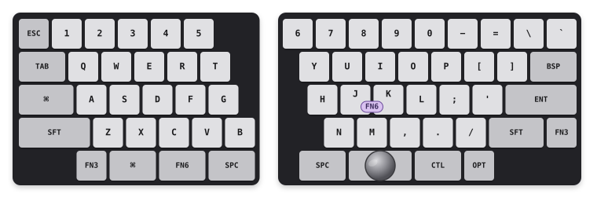
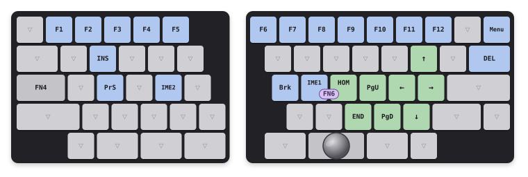
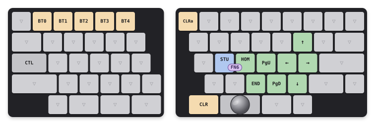
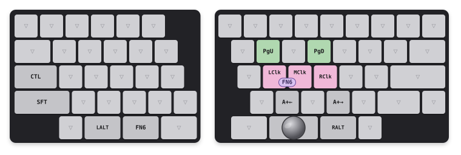
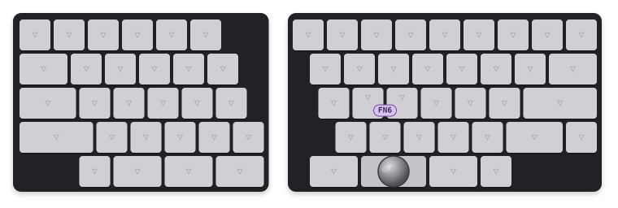
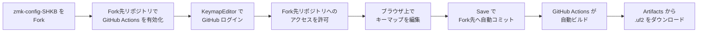
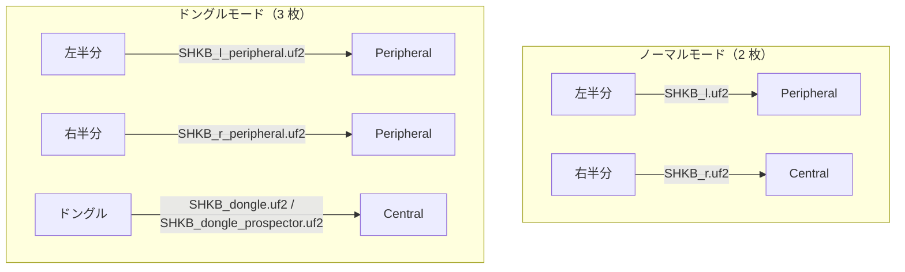

# SHKB

HHKB レイアウトをベースにした 62 キーの左右分割キーボードです。右半分にトラックボール（PMW3610）を搭載しており、ZMK ファームウェアで動作します。

---

## 概要

| 項目 | 内容 |
|------|------|
| キー数 | 62 キー（左 28・右 34） |
| キーピッチ | 17mm |
| マイコン | Seeed Studio XIAO nRF52840 |
| トラックボール | PMW3610, 19mmトラックボール |
| ファームウェア | ZMK v0.3 |
| 接続 | BLE 無線 / USB（ドングル経由） |

---

## レイアウト


---

## ハードウェア

### マイコン
Seeed Studio XIAO nRF52840 を各半分に 1 枚ずつ使用します。ドングルモードではさらに 1 枚追加します。

### キーマトリクス
各半分 7 本の GPIO ピンを使ったチャーリープレックス配線です。ダイオードレスで省ピン接続を実現しています。

### トラックボール
右半分に PMW3610 センサーを SPI で接続します。

- インターフェース: SPI（SCK: P1.13 / MOSI+MISO: P1.15 / CS: D9）
- 割り込みピン: D7
- ドライバ: [badjeff/zmk-pmw3610-driver](https://github.com/badjeff/zmk-pmw3610-driver)

### バッテリー
各半分に LiPo バッテリーを接続可能です。電圧分圧は R_top = 1 MΩ / R_bottom = 510 kΩ（P0.31/AIN7 使用）。

各半分には物理スイッチがあり、バッテリーの接続・切り離しを行えます。USB 接続の有無とスイッチの ON/OFF の組み合わせにより、以下の 4 状態になります。

| 状態 | USB 接続 | 物理スイッチ | バッテリー充放電 | XIAO BLE の駆動 |
|:---:|:---:|:---:|------|------|
| ① | あり | ON | 充電される | USB 電源で駆動 |
| ② | あり | OFF | 充電されない（切り離し） | USB 電源で駆動 |
| ③ | なし | ON | 放電される | バッテリー電源で駆動 |
| ④ | なし | OFF | 充放電なし（完全切り離し） | 停止 |

- **状態①（USB あり・スイッチ ON）**: USB 給電でマイコンが駆動し、バッテリーも充電されます。
- **状態②（USB あり・スイッチ OFF）**: バッテリーが切り離されるため充電されません。USB 給電は BAT 端子を経由しないため、マイコンは USB 電源で駆動します。「バッテリーを充電せずに USB で使いたい」場合に使用します。
- **状態③（USB なし・スイッチ ON）**: バッテリーのみで駆動し、放電が進みます。
- **状態④（USB なし・スイッチ OFF）**: バッテリーが完全に切り離され、放電なし。長期保管に最適です。

> この配線ではスイッチ OFF ＝ バッテリー完全切り離しとなります。USB 接続中にスイッチを OFF にしてもマイコンは動作しますが、充電はされません。充電したいときは必ずスイッチを ON にしてください。

#### バッテリー取り扱い上の注意

LiPo（リチウムポリマー）バッテリーは扱いを誤ると膨張・発火の危険があります。以下を守ってください。

- **満充電のまま放置しない**: フル充電状態で長期間放置すると電圧が自然に上昇し、バッテリーが膨張・発火する恐れがあります。しばらく使わない場合は状態④（USB なし・スイッチ OFF）にして保管し、充電したままキーボードを使わずに放置しないでください。
- **長期保管は 30〜50%（1 セル 3.7〜3.9V 程度）で**: 1 ヶ月以上使わない場合は、満充電・完全放電ではなく 30〜50% 程度まで充電した状態で保管するのが安全です。数ヶ月に一度は電圧を確認してください。
- **充電中は目を離さない**: 特に初回充電時や長期保管後の充電時は、異常な発熱・膨張がないか確認しながら充電し、異常を感じたら直ちに中止してください。
- **過放電させない**: バッテリー残量が極端に低い状態（マイコンが動作しなくなるレベル）まで使い切らないでください。過放電はセルの劣化・破損につながります。
- **物理的な損傷を避ける**: バッテリーをスイッチのピンや鋭利な端子で傷つけない、強く圧迫・落下させないよう注意してください。膨らみ・変形・異臭がある場合は使用を中止してください。
- **極性とコネクタ**: 接続時にコネクタの極性（+/-）を逆にしないでください。逆接続は破損や発火の原因になります。
- **廃棄時**: 端子をテープ等で絶縁してから、バッテリー回収ボックスなど所定の方法で廃棄してください。

---

## 接続モード

### ノーマルモード（ドングルなし）

```
左半分（Peripheral）  ←──BLE──→  右半分（Central）
                                     │
                                    BLE
                                     │
                                  ホスト PC
```

右半分がセントラルとなり、キーマップ処理とトラックボールイベントの処理を担います。トラックボールが右半分に搭載されているため、右半分をセントラルにすることでトラックボールイベントをペリフェラル→セントラル間の BLE 中継を挟まずローカルで処理でき、遅延・ジッタを低減できます。左半分はペリフェラルとして動作します。

### ドングルモード

```
左半分（Peripheral）  ─┐
                       ├──BLE──→  ドングル（Central）── USB ──→ ホスト PC
右半分（Peripheral）  ─┘
```

両半分をペリフェラルにし、ドングルをセントラルとして USB 接続します。ドングルには XIAO BLE 単体か、LCD 付き Prospector キャリアボードが使用できます。

---

## レイヤー構成

| # | 名前 | 用途 | LED |
|---|------|------|-----|
| 0 | **mac** | Mac 向けベースレイヤー（⌘キー） | 消灯 |
| 1 | **win** | Windows 向けベースレイヤー（CTLキー） | 消灯 |
| 2 | **iPad** | iPad 向けベースレイヤー（mac 配列ベース、サムキーは ⌘ / CTL / OPT） | 消灯 |
| 3 | **Function** | FN レイヤー（F1〜F12・ナビゲーション） | 緑 |
| 4 | **Bluetooth** | BT プロファイル切り替え | 黄 |
| 5 | **Mouse** | AutoMouse（トラックボール移動で自動起動） | シアン |
| 6 | **Scroll** | トラックボールをスクロールにリマップ（`J`+`K` 同時押しコンボでも起動） | マゼンタ |

**レイヤーLED**：レイヤーが切り替わると、**左手側**の XIAO BLE 上の RGB LED が上表の色で **1 秒間だけ** 点灯します（電池消費を抑えるため常時点灯はせず、消費電力の大きいトラックボール側も避けています）。点灯中に別のレイヤーへ切り替わると、その色に変わって 1 秒を計り直します。レイヤー状態は split central（ノーマルモードは右手側、ドングルモードはドングル）しか持たないため、central が `&lyr_led` behavior（GLOBAL locality）経由で左手側へレイヤー番号を送っています。実装は [src/layer_led.c](src/layer_led.c)（点灯）/ [src/layer_led_notify.c](src/layer_led_notify.c)（通知）、点灯時間は `CONFIG_SHKB_LAYER_LED_DURATION_MS`（既定 1000）で変更できます。

**電池残量表示**：電源 ON 時、左右それぞれの LED が自身の電池残量に応じて **2 秒間** 点灯します（50〜100% 緑 / 20〜49% 黄 / 19% 以下 赤）。点灯時間は `CONFIG_SHKB_LAYER_LED_BATTERY_MS` で変更できます。

**BT プロファイル表示**：電源 ON 時（電池残量表示の後）と BT プロファイル切り替え時に、右手側の LED が接続先プロファイルの色で **2 秒間点滅** します（Profile 0 赤 / 1 青 / 2 緑 / 3 マゼンタ / 4 黄）。プロファイルを管理する split central で動作するため、ノーマルモードの右手側のみ対応です。点滅時間・間隔は `CONFIG_SHKB_LAYER_LED_PROFILE_MS`（既定 2000）/ `CONFIG_SHKB_LAYER_LED_PROFILE_BLINK_MS`（既定 200）で変更できます。

凡例：`▽` = 下位レイヤーに透過 / <span style="background:#b0c8f0;padding:0 4px">青</span> = ファンクション / <span style="background:#b0d8b0;padding:0 4px">緑</span> = ナビゲーション / <span style="background:#f5dbb0;padding:0 4px">橙</span> = Bluetooth / <span style="background:#f0b8d8;padding:0 4px">桃</span> = マウス / <span style="background:#d9c2f0;padding:0 4px">紫の小札</span> = コンボ（両隣のキーを同時押し）

**コンボ**：`J` と `K` を同時に押している間、Scroll レイヤー（`FN6`）が有効になります（`config/shkb.keymap` の `combos` → `ScrollLayer`、key-positions 36 / 37）。全レイヤーで有効なため、各レイヤー図の J・K の間に `FN6` の札を表示しています。ホームポジションから手を離さずにスクロールへ切り替えられます。同時押しの判定時間は ZMK 既定の 50ms で、それより間隔を空けて押せば通常どおり `J` / `K`（Mouse レイヤーでは `LClk` / `MClk`）として入力されます。

各レイヤー図と冒頭のレイアウト図（`layout.svg` = Layer 0 と同じ図）は `python3 docs/generate_layer_svgs.py` で `config/shkb.keymap` から再生成できます（keymap を変更したら実行してください）。

---

### Layer 0 – mac

Layer 0 が Mac 用ベースレイヤーです。起動時はこのレイヤーが選択されます。ホームロウ左端が ⌘、左右サムの Alt キーはどちらも OPT、右サム右端は CTL。左サムは左から `FN3`（Function）/ OPT / `FN6`（Scroll）/ SPC で、右下の ↑ 位置も `FN3` です。`J`+`K` 同時押しでも Scroll レイヤーに入れます。


---

### Layer 1 – win

Layer 1 が Windows 用ベースレイヤーです。ホームロウ左端が CTL、左右サムの Alt キーは LALT / RALT、右サム右端は ⌘（Win キー）。`FN3` / `FN6` の位置と `J`+`K` コンボは mac と共通です。


---

### Layer 2 – iPad

iPad 接続用のベースレイヤーです。キー配列は Layer 0（mac）をベースに（ホームロウ左端は ⌘）、Alt 位置のサムキーを左から ⌘ / CTL / OPT に入れ替えています。Bluetooth レイヤーの `BT4` で BT_SEL 4 への切り替えと同時にこのレイヤーへ移行します。



---

### Layer 3 – Function（FN）

FN キー（または ↑ キー）を押している間有効になるレイヤーです。F1〜F12・ナビゲーション・IME 切り替え・コンテキストメニュー（右上端の `Menu`）を収録しています。ホームロウ左端（CTL 位置）の `FN4` で Bluetooth レイヤーへ移行します。



---

### Layer 4 – Bluetooth

BT プロファイル切り替えレイヤーです。BT0/1 は Mac モード、BT2/3 は Win モード、BT4 は iPad モードに同時切り替えするマクロです。`CLRa` で全プロファイルを、右サムの `CLR` で選択中のプロファイルをクリアします。`STU` は ZMK Studio のロック解除です。ホームロウ左端の CTL と、Function レイヤーと同じ位置のナビゲーションキー（矢印・HOM/END・PgU/PgD）も使えます。



---

### Layer 5 – Mouse（AutoMouse）

トラックボールを動かすと自動起動（5 秒タイムアウト）するレイヤーです。J/K/L でクリック（左 / 中 / 右）、U/O で PgU/PgD、M/. で Alt(OPT)+← / Alt(OPT)+→。ホームロウ左端の CTL・左 SFT・左右 Alt も使えます。左サムの `FN6` か `J`+`K` 同時押しで Scroll レイヤーへ移行します（J・K を同時に押すとクリックではなくスクロールになります）。



---

### Layer 6 – Scroll

トラックボールの XY 移動をホイールスクロールにリマップします（スケーリング比 1:8）。`FN6`（ベースレイヤー / Mouse レイヤーの左サム）か `J`+`K` 同時押しを押している間だけ有効で、全キーが `▽` 透過です。



---

## キーマップの編集

GitHub アカウントさえあれば、ZMK や devicetree の知識がなくてもブラウザ上でキーマップを編集できます（参考: [roBa ビルドガイド – キーマップの編集](https://github.com/kumamuk-git/roBa/blob/main/doc/v2/buildguide_v2.md#6キーマップの編集)）。

[KeymapEditor](https://nickcoutsos.github.io/keymap-editor/) は、GitHub 上の zmk-config リポジトリと連携し、GUI 上でキーマップを編集してそのままコミットできる Web ツールです。



1. GitHub で [zmk-config-SHKB](https://github.com/chb-usk/zmk-config-SHKB) を Fork します。
2. Fork したリポジトリの **Actions** タブを開き、「I understand my workflows, go ahead and enable them」をクリックして GitHub Actions を有効化します。
3. [KeymapEditor](https://nickcoutsos.github.io/keymap-editor/) にアクセスし、「Login with GitHub」から GitHub アカウントでログインします。
4. 認証画面で Fork したリポジトリへのアクセスを許可します。
5. 読み込まれたレイヤー一覧・キーボード配列から、編集したいキーをクリックしてキーコードを変更します。
6. 編集が終わったら **Save** をクリックすると、Fork先リポジトリへ自動的にコミットされ、GitHub Actions によるビルドが走ります（2〜4 分程度）。
7. ビルド完了後、Fork先リポジトリの Actions タブから該当の実行結果を開き、Artifacts から `.uf2` をダウンロードして [ファームウェア書き込み](#ファームウェア書き込み) の手順で書き込みます。

> [!NOTE]
> 自動生成されるキー配列はあくまで叩き台のため、実機と見た目が異なる場合があります。動作するキーコードの割り当て自体は正しく反映されるので、見た目のずれは気にせず進めて問題ありません。

---

## ビルド

GitHub Actions で自動ビルドされます。生成される `.uf2` ファイルは以下の名前になります。

| ファイル名 | 用途 |
|------------|------|
| `SHKB_l.uf2` | ノーマルモード 左半分（Peripheral） |
| `SHKB_r.uf2` | ノーマルモード 右半分（Central） |
| `SHKB_l_peripheral.uf2` | ドングルモード 左半分 |
| `SHKB_r_peripheral.uf2` | ドングルモード 右半分 |
| `SHKB_dongle.uf2` | ドングル（XIAO BLE） |
| `SHKB_dongle_prospector.uf2` | ドングル（Prospector / LCD付き） |
| `settings_reset.uf2` | 設定リセット |

リポジトリに push するか、Actions タブから手動実行（`workflow_dispatch`）でビルドできます。

---

## ファームウェア書き込み

XIAO nRF52840 は UF2 ブートローダーを内蔵しています。USB 接続時に PC からリムーバブルドライブとして認識させ、そこへ `.uf2` ファイルをコピーするだけで書き込めます。

### 書き込み手順

書き込み対象の基板ごとに、**必ず `settings_reset.uf2` を書き込んでから対象のファームウェアを書き込みます**。これにより、古いペアリング情報（BLE ボンド情報）を引きずったまま新しいファームウェアが起動することを防ぎます。

```mermaid
flowchart LR
    A["GitHub Actions で<br/>ビルド"] --> B["Artifacts から<br/>.uf2 をダウンロード"]
    B --> C["XIAO BLE を<br/>USB 接続"]
    C --> D["リセットボタンを<br/>素早く2回押す"]
    D --> E["ブートローダーモードへ<br/>（XIAO-SENSE ドライブとして認識）"]
    E --> F["settings_reset.uf2 を<br/>ドライブへドラッグ&ドロップ"]
    F --> G["自動的に再起動し<br/>設定がリセットされる"]
    G --> H["リセットボタンを<br/>素早く2回押す"]
    H --> I["再度ブートローダーモードへ"]
    I --> J["対象の .uf2 を<br/>ドライブへドラッグ&ドロップ"]
    J --> K["自動的に再起動し<br/>ファームウェアが反映"]
```



1. GitHub Actions（push または Actions タブからの `workflow_dispatch`）でビルドし、Artifacts から対象の `.uf2`（`settings_reset.uf2` を含む）をダウンロードします。
2. 書き込み対象の XIAO BLE を USB ケーブルで PC に接続します。
3. 基板上のリセットボタンを **素早く 2 回** 押します（ダブルタップ）。LED が点滅し、PC 上に `XIAO-SENSE` という名前のリムーバブルドライブとして認識されます。
4. まず `settings_reset.uf2` をそのドライブへドラッグ&ドロップでコピーします。コピーが完了すると自動的に再起動し、設定がリセットされます。
5. 再度リセットボタンを **素早く 2 回** 押してブートローダーモードに入り直します。
6. 続けて、対象のファームウェア（`SHKB_l.uf2` など）をドライブへドラッグ&ドロップでコピーします。
7. コピーが完了すると自動的に再起動し、ファームウェアが反映されます。

### モード別の書き込み対象



- ノーマルモード: 左右それぞれに対応する `.uf2` を書き込みます（2 枚）。
- ドングルモード: 左右 + ドングルの 3 枚それぞれに対応する `.uf2` を書き込みます。ドングルは XIAO BLE 単体なら `SHKB_dongle.uf2`、Prospector キャリアボードなら `SHKB_dongle_prospector.uf2` を使用します。

> 左右で異なるファームウェアを書き込むため、取り違えないよう注意してください（`_l` = 左半分用、`_r` = 右半分用）。各基板とも、上記手順の通り `settings_reset.uf2` → 対象の `.uf2` の順で書き込みます。

---

## 使用モジュール

| モジュール | 用途 |
|------------|------|
| [zmkfirmware/zmk](https://github.com/zmkfirmware/zmk) @ v0.3 | ZMK 本体 |
| [badjeff/zmk-pmw3610-driver](https://github.com/badjeff/zmk-pmw3610-driver) | PMW3610 トラックボールドライバ |
| [caksoylar/zmk-rgbled-widget](https://github.com/caksoylar/zmk-rgbled-widget) | RGB LED ウィジェット |
| [carrefinho/prospector-zmk-module](https://github.com/carrefinho/prospector-zmk-module) | Prospector ドングル LCD モジュール |

---

## キーテスター（出荷前の動作確認）

[`tools/key-tester.html`](tools/key-tester.html) は、組み立てた SHKB の全 62 キーとトラックボールが正しく動くかを確認するためのページです。インストールは不要で、ファイルをブラウザ（Chrome / Edge / Safari）で開くだけで使えます。

### できること

- 押したキーを盤面上で緑にして、左手 28 キー・右手 34 キーの確認状況を表示する
- キーを離してから 30ms 未満で同じキーが再入力されたら、チャタリングの疑いとして赤く表示する
- トラックボールの上下左右の移動、左・中・右クリック、スクロールを確認する
- 個体番号を入力し、合否・未確認のキー・チャタリング疑いのキーをテキストでコピーする

### 使い方

1. `tools/key-tester.html` をブラウザで開く（リポジトリをクローンするか、ファイルをダウンロードしてダブルクリック）。
2. 画面上部の「確認に使う OS」で **Mac** または **Windows** を選ぶ。
   - Mac: BT0 / BT1（Layer 0: mac）で接続する。A 列の左が ⌘、右下が Ctrl。
   - Windows: BT2 / BT3（Layer 1: win）で接続する。
3. 「個体番号・メモ」に個体を識別する番号などを入力する。
4. ページ内をクリックしてから、全キーを 1 回ずつ押す。**この間はトラックボールに触れない**（ボールを動かすと 5 秒間 Mouse レイヤーになり、J / K / L がクリックに変わるため）。
5. 次のキーは、ブラウザが直接区別できないので手順に沿って確認する。

   | キー | 確認方法 |
   |------|----------|
   | SPACE（左右 2 つ） | 同じ信号を出すため、**左 → 右** の順に押す |
   | FN（左下・右端） | FN 単体では信号が出ないため、**左の FN + `1`**、続けて **右の FN + `1`** を押す（F1 が届けば OK） |
   | SCRL（左親指） | 押しながらボールを上下に転がし、スクロールが届けば OK（J + K の同時押しでもスクロールになる） |

6. 「トラックボール」のパッド上でボールを上下左右に転がし、J / K / L でクリックを確認する。
7. すべて緑になったら「結果をコピー」を押し、出荷記録などに貼り付ける。

### 配列にないキーが届いたとき

ZMK Studio でキー配置を変えた場合など、テスターが知らない信号が届くと「配列にない ○○ を受け取りました」と表示されます。そのときは、**今押した位置のキーを盤面でクリック**すると、そのキーとして登録されます。

- 登録は Mac 用・Windows 用で別々にブラウザに保存され、次の個体の確認でもそのまま使えます。
- 盤面のキーにマウスを乗せると、そのキーとして判定している信号が表示されます。
- 登録を消すときは「登録したキーを消去」を押します。

### 注意

- macOS の ⌘ + Q / ⌘ + W などのショートカットや、Windows の Win キー（スタートメニュー）はブラウザが止められません。修飾キーは単体で押してください。
- 日本語入力はオフにしてから確認してください。
- キーマップ（`config/shkb.keymap`）を変更した場合は、`tools/key-tester.html` 内のキー定義（`const K`、Mac 用の差分は `rebuildCodes()`）も合わせて更新してください。
